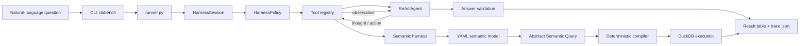

# DeepSeek ReAct Data Analysis Agent

A DeepSeek-powered ReAct data-analysis agent for answering natural-language questions over CSV, JSON, SQLite, and text files, developed for KDD Cup 2026 DataAgent-Bench.

This project is built on the official DataAgent-Bench starter kit. The benchmark dataset and generated run artifacts are intentionally excluded from the public repository; provide them locally through the YAML configuration.

## Architecture

The execution path is:

```text
CLI
  -> runner
  -> HarnessSession / HarnessPolicy
  -> tool registration
  -> ReActAgent
  -> validated answer table
```



### The 13 registered tools

The default registry in `src/data_agent_baseline/tools/registry.py` exposes:

1. `list_context` — list files available under the task context.
2. `read_csv` — preview a CSV file.
3. `read_json` — preview a JSON file.
4. `read_doc` — read a text or Markdown document preview.
5. `search_context` — search text files with literal or regex matching.
6. `extract_doc_records` — extract structured records from narrative documents.
7. `inspect_sqlite_schema` — inspect SQLite tables and columns.
8. `execute_context_sql` — run read-only SQL against a SQLite/DB file.
9. `answer_context_sql` — run a final read-only SQLite query and submit its table.
10. `execute_duckdb` — run read-only DuckDB SQL over CSV/JSON files.
11. `answer_duckdb` — run a final DuckDB query and submit its table.
12. `execute_python` — run Python in a task-scoped subprocess.
13. `answer` — submit a final answer table directly.

Semantic mode adds governed harness actions for `get_semantic_catalog`, `prepare_asq`, `execute_prepared_asq`, and `answer_prepared_asq`. These actions keep physical paths, joins, SQL, and output contracts under harness control when a matching semantic model is available.

### Semantic layer

The semantic path is deterministic after the model proposes an abstract query:

```text
YAML semantic model
  -> semantic catalog and task matching
  -> Analysis Semantic Query (ASQ)
  -> validation, join-path resolution, grain checks, SQL compilation
  -> DuckDB execution over registered SQLite / CSV / JSON sources
```

The compiler validates semantic names, filter operators, output-column contracts, join connectivity, and metric grain before producing SQL. It also records a plan fingerprint for authorization and replay. The current semantic models cover two domains: `debit_card` and `superhero`.

## Harness design

- **Step limit:** `agent.max_steps` defaults to 16.
- **Timeouts:** each tool call has a 45-second hard timeout; Python execution has a 30-second timeout; task wall-clock timeout is configured by `run.task_timeout_seconds`.
- **Timeout retry:** retryable task failures include task timeout, task crash, no answer within the step limit, and transient model connection failures. The runner allows up to four attempts (three retries) and applies a three-times task-timeout wall-clock budget.
- **Validation feedback:** malformed answer tables and invalid final query results are returned to the agent as structured observations so it can repair the answer within the remaining steps.
- **Sandboxing:** every task runs in a separate subprocess when a task timeout is enabled; Python tool execution runs in a task-context subprocess, captures stdout/stderr, truncates oversized output, and terminates timed-out processes. Tool paths are resolved under the task context.
- **Trace replay:** `trace.json` records the session/event stream, state transitions, model and tool telemetry, versions, and replayable SQL/ASQ plans. Replay does not call the model.
- **Run comparison:** the CLI compares raw and semantic experiments or two existing run directories through `compare-modes` and `compare-runs`.

## Installation and usage

The project uses `uv` and declares runtime and development dependencies in `pyproject.toml`.

### Setup

This repository is built on the official starter kit. Download or clone it from [HKUSTDial/DataSpace](https://github.com/HKUSTDial/DataSpace) and place the checkout at `official-dataspace/` in the project root. That directory is intentionally ignored and is not part of the public repository.

```bash
uv sync
uv run pytest
```

Set the model configuration through environment variables. The repository includes `.env.example` as a variable-name template; it is not loaded automatically by Python.

```bash
cp .env.example .env
export DEEPSEEK_API_KEY="<your-key>"
export MODEL_API_URL="https://api.deepseek.com/v1"
export MODEL_NAME="deepseek-chat"
```

The dataset root and run settings are read from a YAML config. The included local configuration is ignored by Git and can be used when the benchmark data is available locally:

```bash
uv run dabench status \
  --config configs/react_baseline.dataspace-supported5.yaml

uv run dabench run-task task_169 \
  --config configs/react_baseline.dataspace-supported5.yaml

uv run dabench run-benchmark --limit 5 \
  --config configs/react_baseline.dataspace-supported5.yaml
```

Other implemented commands are:

```bash
uv run dabench inspect-task task_169 \
  --config configs/react_baseline.dataspace-supported5.yaml

uv run dabench compare-modes --limit 5 \
  --config configs/react_baseline.dataspace-supported5.yaml

uv run dabench compare-runs RAW_RUN_DIR SEMANTIC_RUN_DIR

uv run dabench replay-task task_169 \
  --trace TRACE_JSON --kind sql \
  --config configs/react_baseline.dataspace-supported5.yaml

uv run python evaluate.py RUN_DIR
```

The CLI commands above are implemented in `src/data_agent_baseline/cli.py`; evaluation options are implemented in `evaluate.py`.

## Results

Official 5-question subset accuracy: **0.8**.

## Limitations

- PDF and video inputs are not supported.
- The semantic model covers only two domains.
- The official evaluation reported here covers only five questions.
- No competition ranking was submitted.

## Public-repository policy

The following local assets are ignored and are not part of the intended public snapshot:

- official benchmark input files under `public/input/`;
- generated traces, summaries, and comparisons under `artifacts/runs/`;
- the packaged ZIP under `deliverables/`;
- local `.env`, `*.local.yaml`, IDE metadata, virtual environments, and caches.

Only commit code, tests, semantic model definitions, configuration templates, and documentation after checking `git status` and the staged file list.
